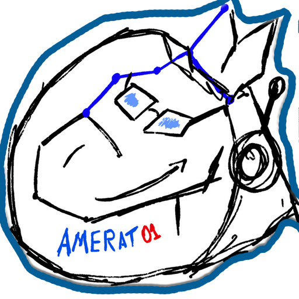

<p align="center"></p>

# HEALTH-01

Astronaut health monitoring for long missions, built by **Team Amerat 01** for the NASA Space Apps Challenge.
It collects wearable, check-in and cabin-sensor data, compares each astronaut with their own normal, flags changes, and explains them in plain language. It works offline.

> **Research prototype, not a medical device.** The demo crew and their data are simulated. The NASA research data (Inspiration4, from NASA OSDR) is real and labelled separately.

The landing page is the front door. The demo opens with no passcode. Nutrition is in the side menu of the demo: meals, fluid and body mass, with example daily marks. The long list of sources sits on its own page, under **references** in the landing menu. Screenshots of the running app are in [docs/screenshots/](docs/screenshots/). The food log is written up in [docs/NUTRITION.md](docs/NUTRITION.md).

## What it does

| | |
|---|---|
| **Collects** | Heart rate, resting HR, HRV, blood pressure, sleep, steps, exercise, fatigue/mood/stress/NASA-TLX check-ins, reaction-time tests, cabin CO₂ / temperature / humidity / pressure / radiation |
| **Normalises** | Every reading goes into one shared schema (astronaut, metric, value, unit, timestamp, device, module, quality, *real / research / simulated*) |
| **Detects** | Personal-baseline anomaly detection (Isolation Forest) and transparent threshold rules. Every alert lists the measurements that triggered it |
| **Predicts** | Fatigue estimate (gradient boosting, simulation model) and 7-day trend forecasts with uncertainty (damped Holt) |
| **Explains** | Conversational assistant (OpenAI or local Ollama models, switchable in the UI) grounded in structured summaries + NASA research passages, with a deterministic **offline fallback** |
| **Integrates** | NASA OSDR API: dataset discovery, provenance, and real Inspiration4 crew blood-panel data |
| **Exercise** | Example programs, goals, manual logs, and in-browser camera rep counting for squats, lunges, and arm raises. Suggestions are rules-based unless a model URL is configured, and health flags stay under human review. |
| **Nutrition** | A food log for each crew member: meals, fluid and body mass, with example daily marks (energy, protein, fluid, calcium, vitamin D, and ceilings for sodium and iron). Seeded rows are simulated. Not a flight menu. See [docs/NUTRITION.md](docs/NUTRITION.md). |
| **Connects** | Phones pair with a device ID and an operator assigns them to a crew member; operators add server links (NOAA space weather, other HEALTH-01 servers, LLM servers, any JSON URL) |
| **Learns** | Plug-in AI models trained on real research data, and a fine-tuning workspace for a space-medicine LLM (Qwen2.5 7B, QLoRA, RAG, evaluation, deploy to Ollama) |
| **Runs on** | Website with a public landing page (`/`) and the demo (`/app`), a separate *serious* edition, a desktop app (Electron), native iOS and Android apps for wearable sync and rep counting |

## Quick start (Docker)

```bash
cp .env.example .env
```

```bash
docker compose up -d --build
```

The first build takes a few minutes, because it installs dependencies and trains the three ML models reproducibly. Then open:

| Service | URL |
|---|---|
| **Website (demo)** | http://localhost:8080 |
| API | http://localhost:8000 |
| API docs (OpenAPI / Swagger) | http://localhost:8000/docs |
| Health check | http://localhost:8000/api/v1/health |

**Live MQTT pipeline** (simulated cabin sensors, own command, not started by the command above):

```powershell
.\scripts\mqtt_sim.ps1
```

The `mqtt-sim` container publishes to Mosquitto. The script assigns those topics, and the Habitat sensors page shows the readings labelled **simulated**. See [docs/MQTT_HABITAT.md](docs/MQTT_HABITAT.md).

**Demo login:** user `mission-control`, passcode `hmt-demo` (set by `DEMO_PASSCODE` in `.env`).
Other accounts: `flight-surgeon`; astronauts `hajid`, `osama`, `hamood`, `haitham`, `mohmmed` (each sees only their own data); and `pilot`, an empty account for uploading **real** HealthKit / Health Connect data from the mobile apps.

The assistant can use **OpenAI**, **local models via Ollama**, or the **offline explainer**. Pick one per chat from the **Model** dropdown on the AI Assistant page; mission control can save it as the default.
- **Ollama:** if Ollama is running on the machine hosting Docker with a chat model installed (for example `ollama pull qwen2.5:7b`), it's detected automatically. No key is needed and data stays local.
- **OpenAI:** set `OPENAI_API_KEY` in `.env`, then run `docker compose up -d`.
- With neither available, the deterministic offline explainer answers. See `ASSISTANT_PROVIDER` / `OLLAMA_*` in `.env.example`.

Verify the running stack and run the tests:

```bash
./scripts/smoke_test.sh
```

```bash
./scripts/test.sh
```

## Web demo on Vercel

A read-only copy of the website with no backend. The API answers are recorded JSON in `web/static-demo/`. The AI pages (Assistant, Models, Fine-tuning) show "Unavailable" and link to the desktop app.

In Vercel, import the repository and set **Root Directory** to `web`. `web/vercel.json` holds the rest. To refresh the recorded data:

```bash
python scripts/build_static_demo.py   # needs backend/requirements.txt installed
```

## Desktop app releases

Push a tag such as `v1.0.0` and `.github/workflows/desktop-release.yml` builds the Electron app (Windows `.exe`, macOS `.dmg`, Linux `.AppImage`) and attaches it to a GitHub release. The website's download links point to `releases/latest`.

## Renaming the product

"HEALTH-01" is a working name. To change it, edit these one-line settings:

| Where | Setting |
|---|---|
| Backend / API | `app_name` in `backend/app/core/config.py` (or `APP_NAME` in `.env`) |
| Website | `APP_NAME` in `web/src/config.ts` (and `<title>` in `web/index.html`) |
| iOS | `AppInfo.name` in `ios/HealthMonitor/HealthMonitor/HealthMonitorApp.swift`, `INFOPLIST_KEY_CFBundleDisplayName` in the Xcode project |
| Android | `app_name` in `android/app/src/main/res/values/strings.xml` |

Any other mention in docs and messages is the exact text `HEALTH-01`, so a project-wide find-and-replace covers the rest. The logo lives in `LOGO CUSTOM/`; after replacing it, run `python scripts/make_logo_assets.py` to regenerate every icon size.

## Repository layout

```
backend/        FastAPI app (api, core, database, modules/*, intelligence, assistant, exercise, schemas) + tests
ml/             datasets (synthetic generator), models (inference), training, evaluation, artifacts
web/            React + TypeScript + Vite + Recharts dashboard (served by nginx in Docker)
services/pose_inference/   optional desktop landmark counter (no video stored)
services/mqtt_simulator/   optional MQTT publisher (profile mqtt-sim; scripts/mqtt_sim.ps1)
ios/HealthMonitor/     SwiftUI app (Xcode project) — HealthKit bridge
android/        Kotlin + Jetpack Compose app — Health Connect bridge
data/           nasa_snapshot (bundled public OSDR files for offline demo), nasa_cache (runtime)
docs/           ARCHITECTURE, DATASETS, AI_MODELS, EXERCISE, MOBILE_SETUP, DEMO
scripts/        test.sh, smoke_test.sh, train_models.sh
```

## Documentation

- [docs/ARCHITECTURE.md](docs/ARCHITECTURE.md): module diagram, interfaces, data flow, security
- [docs/SETUP_WALKTHROUGH.md](docs/SETUP_WALKTHROUGH.md): set up every part (web, serious edition, desktop, phones, local AI, fine-tuning)
- [docs/DEPLOY_DIGITALOCEAN.md](docs/DEPLOY_DIGITALOCEAN.md): online demo on a DigitalOcean GPU or CPU droplet
- [docs/llm/FINE_TUNING.md](docs/llm/FINE_TUNING.md): LLM sources, dataset, RAG, QLoRA training, evaluation, deployment; [results](docs/llm/RESULTS.md)
- [docs/MQTT_HABITAT.md](docs/MQTT_HABITAT.md): connect habitat sensors over MQTT
- [docs/report/SHORT_FORMATS.md](docs/report/SHORT_FORMATS.md): 5-minute deck, 30-second video, bullet points
- [docs/screenshots/](docs/screenshots/): every screen, captured from the running system (`desktop/capture.js`)
- [docs/report/HEALTH-01_REPORT.md](docs/report/HEALTH-01_REPORT.md): what the system implements, results and limitations
- [docs/NASA_CHALLENGE_RESOURCES.md](docs/NASA_CHALLENGE_RESOURCES.md): every official challenge resource, what it contains, and how the tool uses it
- [docs/DATASETS.md](docs/DATASETS.md): NASA datasets, URLs, provenance, limitations
- [docs/AI_MODELS.md](docs/AI_MODELS.md): models, training data, metrics, limitations
- [docs/ai/README.md](docs/ai/README.md): AI engine with real-data models (PMData, Stanford illness, CGMacros, MMASH, CVES), model registry, model cards, alert and exercise contracts
- [docs/EXERCISE.md](docs/EXERCISE.md): exercise programs, camera counting, recommendations, and the versioned data contract
- [docs/MOBILE_SETUP.md](docs/MOBILE_SETUP.md): iOS and Android setup and connection addresses
- [GUIDE.md](GUIDE.md): quick reference with logins, passcodes, URLs and commands
- [docs/DEMO.md](docs/DEMO.md): five-minute hackathon demo script

## Local development without Docker

```bash
python -m venv .venv && .venv/Scripts/pip install -r backend/requirements.txt   # Windows path; use .venv/bin on macOS/Linux
python -m ml.training.train_all
cd backend && PYTHONPATH="..:." uvicorn app.main:app --reload       # SQLite by default
cd web && npm install && npm run dev                                 # http://localhost:5173 (proxies /api to :8000)
```
