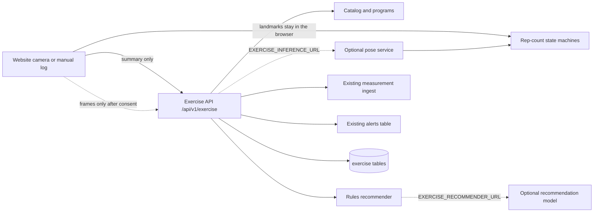

# Exercise and fitness

The exercise module is a separate package (`backend/app/exercise`) plus a thin registry adapter (`backend/app/modules/exercise`). It does not replace measurements, alerts, or the assistant. Workouts that should count toward the health dashboard are written through the existing ingestion path as `exercise_minutes` and, when the user typed one, `heart_rate`.

Every program and recommendation in this module is an **example for the demo**. It is not a medical prescription, a rehabilitation plan, or a NASA flight protocol.

## Architecture



| Piece | Role |
|---|---|
| `catalog.py` | Exercise definitions. Add a movement here first. |
| `programs.py` | General, mission, and personalized example programs. |
| `tracking.py` | One state machine per camera-counted exercise. |
| `goals.py` | Daily, weekly, monthly, and yearly completion, streaks, missed days. Pure functions. |
| `recommendations.py` | Rules engine and the optional model port. |
| `inference_api.py` | Landmark counting and the gated frame hook. |
| `service.py` | Profiles, sessions, health sync, review alerts. |
| `routes.py` | Versioned HTTP contract `1.0.0`. |
| `web/src/exercise` | Browser counter and camera screen. |
| `services/pose_inference/server.py` | Optional desktop process. It does not store video. |

Astronauts only see their own rows. Other crew ids return **404**, the same rule as the rest of the API. Mission control and the flight surgeon can read the crew.

## Setup

The module is on by default. No extra install is required for programs, manual logs, goals, or the rules recommender.

Camera counting in the browser downloads MediaPipe Tasks Vision (Apache-2.0) and the Pose Landmarker lite model on first use:

- WASM: `EXERCISE_POSE_WASM_URL` (default jsDelivr)
- Model: `EXERCISE_POSE_MODEL_URL` (default Google-hosted lite model)

For an offline demo, host those files yourself and set the two variables. The rest of the site still runs if the download fails; the screen tells the person to log the workout manually.

```bash
# optional desktop counter, landmarks only, loopback
set INFERENCE_TOKEN=choose-a-long-token
python services/pose_inference/server.py
```

In `.env`:

```bash
EXERCISE_INFERENCE_URL=http://127.0.0.1:8090
EXERCISE_INFERENCE_TOKEN=choose-a-long-token
EXERCISE_ALLOW_REMOTE_FRAMES=false
EXERCISE_RECOMMENDER_URL=
EXERCISE_RECOMMENDER_TOKEN=
```

From Docker, point `EXERCISE_INFERENCE_URL` at `http://host.docker.internal:8090`. Put TLS in front of the service before binding it to anything other than loopback. The API already refuses to forward frames unless `EXERCISE_ALLOW_REMOTE_FRAMES=true` and the caller sends `consent: "explicit_frame_upload"`.

## Platforms

| Client | How exercise works |
|---|---|
| Desktop browser | Full module, including in-browser pose counting on localhost or HTTPS. |
| Phone browser (Android Chrome, iOS Safari) | Same website. Layout collapses under 820px. Pose counting depends on WASM and camera permission. If it fails, use manual entry. |
| Native iOS / Android apps | Unchanged HealthKit and Health Connect bridges. Their exercise minutes still land in `exercise_minutes` and show on the exercise dashboard as wearable minutes, separate from workouts logged in this module. |
| Desktop inference host | Optional. Counts landmarks, or frames only with consent and an explicit server flag. |

Camera counting prefers the browser. It uses the desktop service only when that service is configured **and** the person allows it. Otherwise it stays on manual entry.

## Camera and pose model

Supported tracked exercises: **squat**, **forward lunge**, **arm raise**.

Requirements that actually affect the count:

- Full body in frame: head, both hips, both knees, both feet. Arm raises also need both shoulders and wrists.
- About 2–3 metres from the camera, so the whole body fits.
- Squats and lunges are clearer from a slight side angle. Arm raises are clearer facing the camera.
- One person, steady camera, light that separates the body from the background.
- Joint visibility below 0.5 drops tracking. About 2.5 seconds without a body suggests ending the set.

The counter is a phase machine on joint angles (or wrist height for arm raises). It is not a 3D biomechanics model. Depth, occlusion, baggy clothing, and a second person in frame will miscount. Form notes are limited to "this attempt never reached the depth threshold" and "the two sides disagree a lot." They are easy to fool with camera angle. Do not treat them as coaching.

Microgravity is not modeled. This prototype assumes a ground camera.

## Adding an exercise

1. Add an `ExerciseDef` in `backend/app/exercise/catalog.py` (id, category, equipment, default sets, reps or duration, rest, cues).
2. Reference that id from a program in `programs.py`, or let the personalized builder pick it up from a template.
3. To count it with the camera, add a spec entry and a signal branch in `tracking.py`, then the same spec numbers in `web/src/exercise/counters.ts` (`FALLBACK_SPEC` and `signal`).
4. Add a short sequence test in `backend/tests/test_exercise.py` that counts a clean repetition and ignores a flicker.
5. Leave `example_only` behavior in place. Do not describe the new movement as a prescription.

Categories already used: `strength`, `cardio`, `mobility`, `rehab`. Rehab entries are examples of gentler movements, not therapy.

## Adding a tracking algorithm

`RepCounter.update(landmarks, t_ms)` is the whole interface. A new algorithm can replace the body of `update` or sit beside it, selected by the spec's `signal` field. Landmark names are `left_hip`, `left_knee`, `left_ankle`, and the same for the right side, plus shoulders and wrists.

The desktop service calls the same class. The browser class must accept the spec from `GET /api/v1/exercise/tracking-spec` so thresholds are not forked by accident. `FALLBACK_SPEC` is only for when that request fails.

To decode pixels on the desktop service, set `app.exercise.inference_api.FRAME_DECODER` to a function `(image_bytes) -> landmarks`. Until that is set, frame uploads return 503 (no runtime) or 501 (runtime present, no decoder). The image is not written to disk.

## Connecting a recommendation model

Set `EXERCISE_RECOMMENDER_URL`. The API POSTs:

```json
{
  "contract_version": "1.0.0",
  "astronaut_id": "AST-001",
  "profile": {"fitness_level": "intermediate", "focus": "balanced", "limitations": "", "equipment": ["bodyweight"], "mission_phase": "in_flight"},
  "health_context": {"contract_version": "1.0.0", "fatigue_score": 3, "sleep_duration_h": 7.2},
  "adherence_pct": 80,
  "weekday": 0
}
```

The response must include `contract_version` `"1.0.0"`, `source`, and `items`. Also send `reason`, `model`, `confidence`, `requires_human_review`, and `review_reasons` when you have them.

If the URL is empty, the call fails, or the body is the wrong shape, the rules engine answers and `fallback` is `"rules"`.

Local safety flags are applied **after** the model returns. High fatigue (6+), sleep under 5 hours, SpO2 under 92%, or an open health warning forces `requires_human_review`. A model cannot clear those flags. The rules engine then suggests easy mobility examples only, and the text says a person has to review them. Any limitation note on the profile, or a rehab focus, does the same.

`GET /api/v1/exercise/contracts` lists the shapes. `GET /api/v1/exercise/astronauts/{id}/health-context` and `.../summary` are the stable reads for a later model. They are versioned `1.0.0`.

## Data schema

Tables, created with the rest of the schema on startup:

| Table | What it stores |
|---|---|
| `exercise_profiles` | One row per astronaut: level, focus, equipment, limitation note, mission phase. |
| `exercise_assignments` | Snapshot of the general, mission, and personalized example program. |
| `workout_sessions` | One completed session: source (`manual`, `camera`, `imported`), times, exercises, summary, optional RPE and average heart rate. Unique on `(astronaut_id, client_id)`. |
| `exercise_goals` | Daily minutes and weekly, monthly, and yearly session targets. Marked example-only. |

Session summary fields used by the UI: `minutes`, `reps`, `completed_sets`, `form_flags`, `strategy`, and `kind` (one category, or `mixed`). The AI engine reads `workout_sessions` read-only and maps each row onto `exercise_session_summary.v1` (`docs/ai/EXERCISE_INTEGRATION.md`). This module does not write the AI tables.

Health sync writes:

- `exercise_minutes` with `source_module=exercise` and `external_id=exercise:{id}:minutes`
- `heart_rate` only when the user supplied an average, `external_id=exercise:{id}:hr`

Seeded demo sessions are `data_class=simulated` and `sync_health=false`, so they do not double-count the simulator's exercise minutes. A workout a person logs is stored as `real` unless a crew-wide user is writing into a simulated astronaut, in which case it keeps that astronaut's class.

Wearable minutes (Apple Health, Health Connect, the simulator) stay in the measurement table. The exercise progress payload reports them separately as `wearable_exercise_minutes_7d`.

## Health and alerts

| Event | What happens |
|---|---|
| Session saved with sync on | `exercise_minutes` enters the normal pipeline, including the existing activity adherence rule. |
| Logged average heart rate ≥ 175 bpm, or ≥ resting + 50 bpm and ≥ 140 | A `caution` alert, category `exercise`, source `rule:exercise-review`. The text asks for a person to look. It does not change the program. |
| Yesterday was on the example schedule and has no log | An `info` alert, one per day. |
| Mid-week adherence under 50% of the example weekly target | A `caution` alert, one per week. |

Alerts are the same rows the dashboard and assistant already read. Dedupe keys start with the astronaut id.

## User guide

1. Sign in. Astronauts land on their own record. Mission control can switch crew members at the top of **Exercise & Fitness**.
2. **Dashboard** shows today's minutes, the week, a streak, 30-day minutes, weekly adherence, and exercise alerts.
3. **Program** has three examples: a personalized plan, the general crew plan, and a long-duration mission mix. Saving the profile rebuilds the personalized plan. Mentioning a knee swaps squats and lunges for gentler examples and flags the plan for review. A limitation note or a rehab focus always flags review.
4. **Calendar** marks logged days and scheduled days with no log.
5. **Library** lists the catalog. "Camera" means the browser can count it.
6. **Camera** starts on-device counting for squat, lunge, or arm raise. Save stores the rep summary only.
7. **Log** is the manual form: exercise, minutes, sets, reps, effort, optional heart rate.
8. **Goals** edits the example daily, weekly, monthly, and yearly targets and lists recent missed days.
9. **Recommendations** shows the reason, the source (`rules:...` or a model id), confidence, and a review banner when a health flag is present.

Stop a set if something hurts, and tell the crew medical officer. The page cannot clear you to train.

## Developer guide

- Contract version constant: `app.exercise.CONTRACT_VERSION` (`1.0.0`).
- Routes are mounted from `app.main` and tagged `exercise` in OpenAPI (`/docs`).
- Modules still must not import each other. The exercise package may call `intelligence.ingest` and read daily metrics. It does not import other device modules.
- Disable the registry adapter with `HMT_DISABLED_MODULES=exercise`. The HTTP routes stay available; only the Modules-page adapter and generic measurement ingest for that module id stop.
- Tests: `backend/tests/test_exercise.py` (counters, goals, programs, strategy, consent, isolation, manual log, health sync, rules fallback).
- Browser counter: `web/src/exercise/counters.ts`. Camera UI: `web/src/exercise/CameraPanel.tsx`. Page: `web/src/pages/Exercise.tsx`.

### Better-GYM

[JaronTu/Better-GYM](https://github.com/JaronTu/Better-GYM) is an MIT-licensed fork of [yo-WASSUP/Good-GYM](https://github.com/yo-WASSUP/Good-GYM). That project is a desktop PyQt application using OpenCV, ONNX Runtime, and rtmlib. Its license would allow reuse with attribution. It was not copied. Embedding that UI and model stack would fight this app's browser-first, no-video-by-default design. The counter here is an original phase machine on MediaPipe landmarks.

## Known limitations

- Three camera exercises, validated on synthetic landmark sequences, not on a filmed set in this environment.
- No live camera check was possible here (no camera was attached to the test run). Permission failure, local model failure, and remote refusal are covered by unit tests and by the UI branches.
- MediaPipe weights are downloaded at runtime, not vendored.
- The frame decoder hook is intentionally empty. Remote frame mode returns 503 until a decoder is registered and frames are explicitly allowed.
- Rep counts and form notes are not reliable enough for operational decisions.
- Personalized plans are keyword rules (`knee`, focus, equipment, level), not an assessment.
- Demo targets (60 min/day, 6 sessions/week, 24/month, 250/year) are placeholders.
- Native iOS and Android apps do not embed a pose camera. Use the website on those devices.
- iOS Safari WASM support varies. Failure falls back to manual entry.
- The assistant's own context builder is unchanged. Models that need exercise detail should call the versioned exercise endpoints rather than scraping the dashboard.
