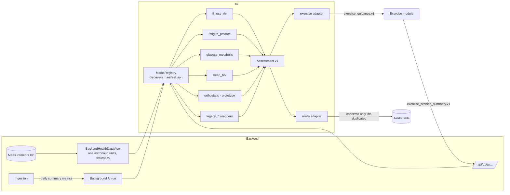

# AI engine: architecture guide

The AI engine (`ai/`) is a plug-in platform. A model is a folder with a `manifest.json` and a Python class; the core
application never names individual models. Models read health data through one interface, return one standard
`Assessment`, and can raise alerts and inform the exercise module through versioned contracts.

**Evidence levels are stated everywhere.** Current models are trained or evaluated on **Earth-based research data** or
**simulated data**. None has been validated on astronauts. The NASA challenge resources (see
[../NASA_CHALLENGE_RESOURCES.md](../NASA_CHALLENGE_RESOURCES.md)) supply spaceflight *context*, not training data.



## Layout

```
ai/
  core/          types.py (manifest, FeatureSpec, Assessment), data.py (HealthDataView + input checks), plugin.py (base class)
  registry/      registry.py (discovery, enable/disable state, lazy load, timeouts, isolation)
  models/        one folder per model: manifest.json, model.py, artifacts/, report.json
  datasets/      downloaders with provenance (pmdata.py, others.py, common.py)
  preprocessing/ signals.py (HRV, baselines, CGM, HOMA-IR), daily_features.py, orthostatic.py
  training/      reproducible training scripts
  evaluation/    real-data evaluations (Stanford illness, MMASH verification, CVES orthostatic)
  inference/     (provider hooks; local in-process provider is built into the registry)
  adapters/      alerts.py (Assessment -> alert event), exercise.py (exercise contracts + guidance)
  documentation/ generate_cards.py, template_model/
  tests/         engine tests (no backend needed)
backend/app/ai_engine/   backend data view, persistence, alert bridge, API routes
contracts/               exported JSON Schemas (exercise_session_summary.v1, exercise_guidance.v1, ai_assessment.v1)
```

## Guides

| Guide | |
|---|---|
| [REGISTRY.md](REGISTRY.md) | Model registry, plug-in contract, **how to add a new model** |
| [TRAINING_AND_EVALUATION.md](TRAINING_AND_EVALUATION.md) | Re-download data, retrain, re-evaluate, regenerate cards |
| [DATASETS.md](DATASETS.md) | Dataset inventory, licences, provenance |
| [model_cards/](model_cards/) | One card per model (generated) |
| [PERFORMANCE.md](PERFORMANCE.md) | All evaluation results (generated) |
| [API.md](API.md) | AI inference API reference |
| [HEALTH_DATA.md](HEALTH_DATA.md) | Health data integration |
| [ALERTS.md](ALERTS.md) | Alerts integration |
| [EXERCISE_INTEGRATION.md](EXERCISE_INTEGRATION.md) | Exercise module contracts |
| [DEPLOYMENT.md](DEPLOYMENT.md) | Setup, execution environments, configuration |
| [LIMITATIONS.md](LIMITATIONS.md) | Limitations and future research |

## Model summary

| Model | Data | Evidence | Key result (actual) | Default |
|---|---|---|---|---|
| `illness_rhr` | Stanford smartwatch illness study | Earth research | Held-out: sensitivity 79% (24 events), day specificity 95.8%, ~1 false-alert episode per 30 healthy days, median alert 1 day before symptoms | on, raises caution alerts |
| `fatigue_pmdata` | PMData (16 people, real self-reports) | Earth research | Wearable-only LOSO AUC 0.55 (tired), 0.55 (stressed); yesterday's self-report alone 0.62 / 0.68 | on, informational only |
| `glucose_metabolic` | CGMacros (45 people) | Earth research | CGM insulin-resistance flag LOSO AUC 0.83 (95% CI 0.68-0.95); post-meal rise MAE 18.6 mg/dL vs 26.6 carbs-only | on, informational |
| `sleep_hrv` | MMASH (verification) | Rule-based | HR from RR vs device MAE 1.1 bpm (r 0.99); sleep-efficiency formula exact | on, informational |
| `orthostatic` | CVES sit-to-stand | Earth research | BP-change agreement with published values only moderate (r ~0.5) | **off** (research prototype) |
| `legacy_*` | Simulated | Simulation | Original models; legacy anomaly on real Stanford data: sensitivity 46%, specificity 98.2% | on, no AI alerts (original rule path unchanged) |
